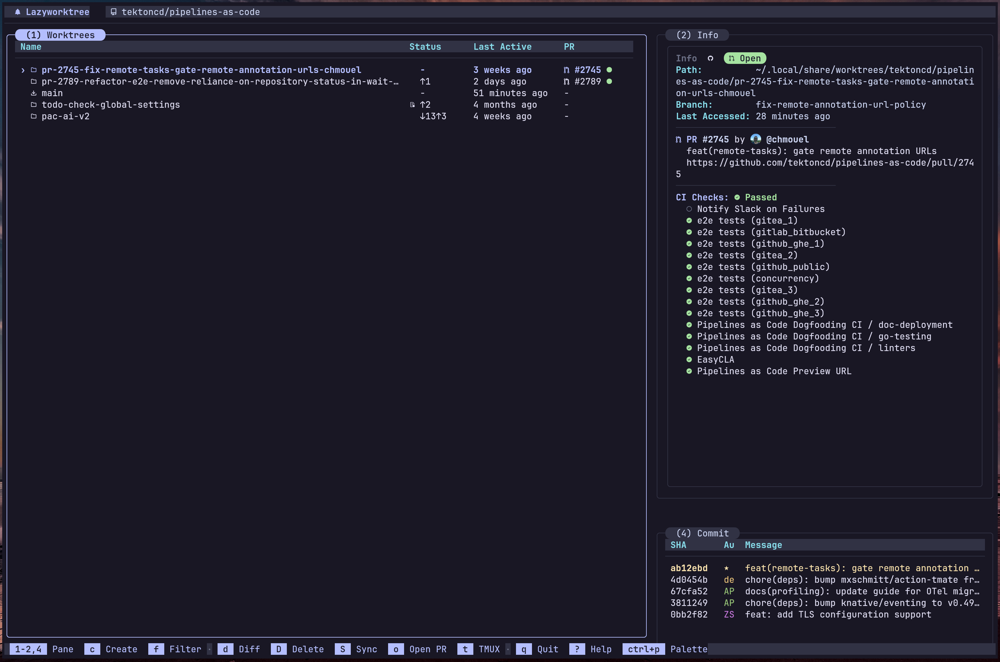

 

# LazyWorktree


LazyWorktree is a keyboard-driven terminal UI for managing Git worktrees.

Manage multiple Git worktrees from one interface: create, remove, and switch between them without navigating between directories.

Built with [Bubble Tea](https://github.com/charmbracelet/bubbletea), LazyWorktree shows worktree state and supports tmux, Zellij, Docker, and Podman.

## Screenshot



_[More screenshots](https://chmouel.github.io/lazyworktree/#screenshots)_

## Main Features

- Worktree management: Create worktrees from branches, PRs/MRs, or issues; clean up merged worktrees without discarding uncommitted changes; list and switch between worktrees.
- CI and PR/MR status: View GitHub Actions and GitLab CI results, PR/MR details, and logs.
- Agent sessions pane: View confirmed active Claude, Codex, Copilot, and pi sessions attached to the selected worktree.
- Command palette: Press `?` to open the palette for actions and custom commands.
- Tmux and Zellij support: Open worktrees in tmux windows or panes, or Zellij tabs.
- Docker/Podman support: Run commands in containers for a worktree.
- Custom commands: Configure shell commands, bind them to keys, and list them in the palette.
- Notes: Keep Markdown notes for each worktree.
- Hooks: Automate worktree setup and cleanup with `.wt` files.
- Customise worktree metadata: Press `e` in the worktree pane to edit the selected worktree's description, colour, notes, icon, and tags.
- Shell helpers: Jump to a worktree with `cd "$(lazyworktree)"`. Completions are available for Bash, Zsh, and Fish.
- LLM-friendly CLI: Use `doctor`, `describe`, `worktrees ...`, and `notes get` to help LLM agents inspect and manage worktrees.

## Documentation

Primary documentation lives on the docs site:

- <https://chmouel.github.io/lazyworktree/docs/>

Useful entry points:

- Introduction: <https://chmouel.github.io/lazyworktree/docs/>
- Getting started: <https://chmouel.github.io/lazyworktree/docs/getting-started/>
- Core workflows: <https://chmouel.github.io/lazyworktree/docs/core/worktree-operations/>
- Navigation and keybindings: <https://chmouel.github.io/lazyworktree/docs/core/navigation-and-keybindings/>
- Configuration overview: <https://chmouel.github.io/lazyworktree/docs/configuration/overview/>
- Configuration reference: <https://chmouel.github.io/lazyworktree/docs/configuration/reference/>
- Full configuration example: [`config.example.yaml`](config.example.yaml)
- CLI overview: <https://chmouel.github.io/lazyworktree/docs/cli/overview/>
- CLI flags reference: <https://chmouel.github.io/lazyworktree/docs/cli/flags/>
- CLI commands reference: <https://chmouel.github.io/lazyworktree/docs/cli/commands/>
- Troubleshooting: <https://chmouel.github.io/lazyworktree/docs/troubleshooting/diagnostic-guide/>

## Installation

### Homebrew (macOS)

```bash
brew tap chmouel/lazyworktree https://github.com/chmouel/lazyworktree
brew install lazyworktree --cask
```

### Arch Linux

```bash
yay -S lazyworktree-bin
```

### From source

```bash
go install github.com/chmouel/lazyworktree/cmd/lazyworktree@latest
```

## Quick Start

```bash
cd /path/to/your/repository
lazyworktree
```

## Shell Integration

To jump to the selected worktree from your shell:

```bash
cd "$(lazyworktree)"
```

For shell integration helpers, see:

- <https://github.com/chmouel/lazyworktree/blob/main/shell/README.md>

## Requirements

- Git 2.31+
- Forge CLI (`gh` or `glab`) for PR/MR status

Optional tools are documented here:

- <https://chmouel.github.io/lazyworktree/docs/getting-started/#requirements>

## Author
[](https://github.com/sponsors/chmouel)
### Chmouel Boudjnah

- Fediverse - <[@chmouel@chmouel.com](https://fosstodon.org/@chmouel)>
- Twitter - <[@chmouel](https://twitter.com/chmouel)>
- Blog - <[https://blog.chmouel.com](https://blog.chmouel.com)>

## Licence

[Apache-2.0](./LICENSE)
