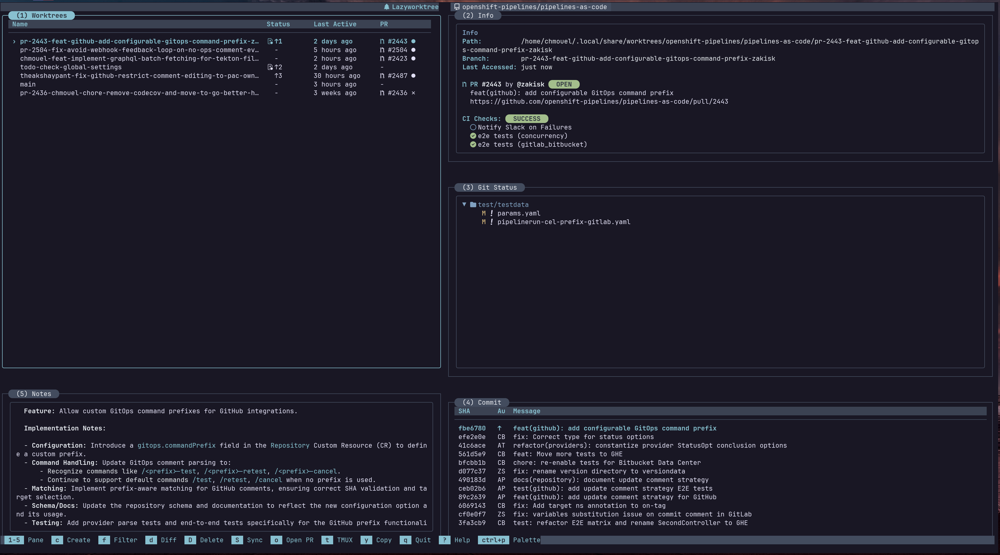

# Command Palette

The command palette is the fastest way to trigger actions without remembering every key.




## Opening and Filtering

- Open with `F1`, `Ctrl+p`, or `:`.
- Type to filter actions and custom commands in real time.
- MRU (Most Recently Used) ordering prioritises recently used entries at the top.

## Built-in Workflows

The palette surfaces all available actions, including:

- Worktree actions: create, delete, rename, set icon, set colour, absorb, prune, and sync.
- Commit flow: search for **Open commit screen** to open the staged commit modal.
- Git operations: lazygit, cherry-pick, and diff viewing.
- Navigation and pane controls: focus a pane, toggle zoom, or switch layout.
- Settings: select a theme with a live preview.

The letter on the right of each entry indicates its keybinding (if any) for
quick reference.

For icon picker usage guidance and examples, see [Worktree Operations](worktree-operations.md#custom-worktree-icons).

## Custom Command Integration

Custom commands defined in your `config.yaml` appear at the top of the palette for quick access. Each custom command shows its description and assigned keybinding when one exists.

If a custom command key starts with `_`, it is palette-only: it appears in the palette, but it is not bound to a direct TUI shortcut or shown in footer key hints.

Session-oriented custom commands (tmux/zellij/herdr) also expose active sessions and Herdr workspaces in the palette, letting you switch between sessions or create new ones. Herdr workspaces are listed from the current or default Herdr session only. A workspace is matched to its worktree by the LazyWorktree tag or by its checkout path, so workspaces opened from Herdr's own worktree picker are listed as well (see `worktree_group` in [Custom Commands](../custom-commands.md)). tmux sessions and Herdr workspaces appear under their full names with the worktree they belong to as description. Herdr session entries show the name with the configured session prefix removed, but selecting one attaches to the full session name, so the prefix is never applied twice.

For full command schema, see [Custom Commands Reference](../custom-commands.md).

## Suggested Configuration

In `config.yaml`:

```yaml
palette_mru: true
palette_mru_limit: 5
```

| Option | Default | Description |
| --- | --- | --- |
| `palette_mru` | `true` | Enable MRU sorting in the palette |
| `palette_mru_limit` | `5` | Number of recent items to prioritise |
